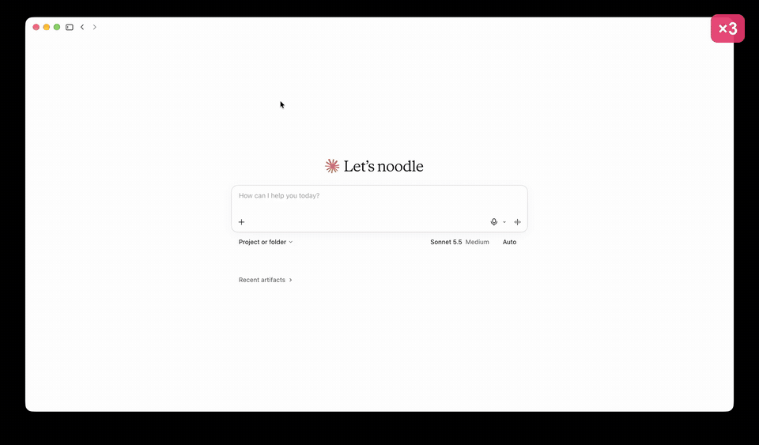

# ouigo-iryo

**Ouigo España fares in your terminal and in your AI agent.** Trains, all three fare levels and the cheapest day of the month, as JSON. Plus a ready-made Iryo booking link. Unofficial, not affiliated with Ouigo or Iryo.

<p align="center">
  
</p>

<p align="center">
  <a href="LICENSE"></a>
  
  
  
</p>

Renfe already has a great open CLI ([luisgonzaleznf/renfe-cli](https://github.com/luisgonzaleznf/renfe-cli)). Ouigo had nothing that works without borrowing the website's own login. This fills that gap, and speaks the **same JSON** as renfe-cli, so you can compare Renfe, Avlo and Ouigo trains in one list.

## What it does

- **`search`**: every Ouigo train on a day, with times, the real departure station (Atocha or Chamartín) and all fares (Esencial, Plus, Full), cheapest first.
- **`calendar`**: the cheapest price for each day in a date range. Find the €9 day before you pick the train.
- **`open`**: Ouigo's own booking page with route **and date** filled in. You choose and pay there; this tool never touches payment.
- **`stations`**: Ouigo's stations, matched by name (accents and case ignored) with typo suggestions.
- **`iryo`**: a ready-made link to Iryo's own booking page for your route and date. No fares (see below).
- **MCP server**: the same four abilities for Claude Desktop, Claude Code or any MCP client.

## Install

You need Python 3.12+, [uv](https://docs.astral.sh/uv/) and **Google Chrome** installed. The tool drives your own Chrome, so there's no separate browser download.

```sh
uv tool install git+https://github.com/zheng2026/ouigo-iryo
ouigo --help
```

## Quick start

```sh
ouigo stations valencia
ouigo calendar Madrid Valencia --from 2026-12-01 --to 2026-12-31     # cheapest price per day
ouigo search Madrid Valencia -d 2026-12-15                            # trains in departure order
ouigo search Madrid Valencia -d 2026-12-15 --sort price --limit 3     # cheapest first
ouigo search Madrid Barcelona -d 2026-12-12 --after 17:00
ouigo open Madrid Valencia -d 2026-12-15                              # Ouigo's page, ready to book
```

Pipe it anywhere:

```sh
ouigo search Madrid Valencia -d 2026-12-15 --sort price --limit 3 \
  | jq -r '.trains[] | "\(.departure[11:16]) \(.service) from \(.fares[0].price) €"'
# 07:15 06472 from 9 €
# 12:15 06822 from 17 €
# 17:45 06572 from 19 €
```

### Ouigo and Renfe in one list

Both tools print the same layout, so merging them is one `jq` line (with [renfe-cli](https://github.com/luisgonzaleznf/renfe-cli) installed):

```sh
{ ouigo search Madrid Valencia -d 2026-12-15; renfe search Madrid Valencia -d 2026-12-15; } \
  | jq -s '[.[].trains[]] | sort_by(.fares[0].price) | .[:5][] | {type, service, departure, price: .fares[0].price}'
```

## Use it from an AI agent (MCP)

<p align="center">
  
</p>

Ask in plain words; the assistant picks the tools. This is a real run, lightly shortened ([full transcript](docs/mcp_transcript.md)):

<p align="center">
  
</p>

```json
{
  "mcpServers": {
    "ouigo": { "command": "/Users/YOU/.local/bin/ouigo-mcp" }
  }
}
```

After `uv tool install`, the `ouigo-mcp` command lives in `~/.local/bin`. Desktop apps don't read your shell's PATH, so give the full path (`which ouigo-mcp` prints it).

Tools: `search_trains(origin, destination, date)`, `cheapest_days(origin, destination, start, end)`, `find_station(query)`, `shop_link(origin, destination, date)`, `iryo_link(origin, destination, date)` (link only, no fares).

Tip: in Claude, Sonnet answers these questions noticeably faster than Opus.

Ouigo answers (`search_trains`, `cheapest_days`) also carry an `iryo` link for the same route and day, and the server tells the assistant to show it, so both companies appear in one answer.

## Iryo: a ready link, no fares

```sh
iryo open Madrid Valencia -d 2026-12-15          # opens Iryo's page in your browser
iryo open Madrid Valencia -d 2026-12-15 --print  # just print the link (--json for details)
iryo stations sevilla
```

Iryo blocks automated access, so this tool never contacts Iryo: it only builds the link, and you open it and see the trains and fares there. "Madrid" means all Madrid stations. Iryo's València trains use Chamartín, not Atocha; if you pick a pair Iryo is known not to run, you get a warning (the page would say "No hay datos de billetes").

Ouigo `search` and `calendar` results include both companies' links for the same day (the cheapest day for `calendar`): `shop` for Ouigo and `iryo` for Iryo (`null` if Iryo does not serve the pair).

## How it works, and what it never does

Your installed Chrome opens Ouigo's **public search page** headlessly, exactly as if you'd opened it, and the tool reads the results that page receives.

- **No login and no credentials.** It never reads, stores or replays tokens or headers, and never calls Ouigo's servers on its own.
- **No bot-check evasion.** No stealth plugins, no fingerprint tricks, no proxies. If Ouigo shows a challenge or answers 403, it stops and says `blocked`.
- **Gentle:** one page at a time, at least 2 seconds apart, and one retry on a plain timeout.
- **Never pays.** `open` hands you Ouigo's page; buying is between you and Ouigo.

## Output and errors

`search` uses renfe-cli's keys: `date`, `origin`, `destination`, `passengers`, `fares_included`, `notice`, `count`, `trains`, `shop`, `delays_included`, `retries`. Each train has `service`, `type` (`"OUIGO"`), `departure` and `arrival` as full local timestamps, `duration_minutes`, `changes`, `available`, and `fares` (`{name, price, currency}`, cheapest first). Ouigo publishes no live delays, so `delay_minutes` and `live_train` are always `null`. Extras: `source`, `fetched_at`, `origin_station`/`destination_station` per train, and a `family` per fare. A day with no trains isn't an error: `count` is 0 and `notice` says so.

`calendar` returns `days` (`date`, `price`, `is_promo`, `is_best_price`) and `cheapest`.

Errors go to stderr as `{"error": {"code": …}}`, with renfe-cli's exit codes:

| Code | Meaning |
|---|---|
| `0` | ok; check `notice` |
| `1` | internal error (only the exception type is shown), or Chrome not found |
| `2` | usage: unknown station (with suggestions), bad date, bad input |
| `5` | blocked or upstream: challenge page, 403/429, timeout |
| `7` | Ouigo changed its site and the response no longer parses |

## Limits

- Slow-ish: about 5–10 seconds per search, because a real browser loads the page.
- It breaks when Ouigo redesigns its site. Exit code 7 tells you when.
- Automated use may conflict with Ouigo's terms of use. Use it gently, for personal trip planning.
- One adult, one way. Return trips and discount cards aren't supported yet.

## En español

`ouigo-iryo` consulta los precios de Ouigo España desde la terminal o desde un agente de IA (MCP): trenes, las tres tarifas y el día más barato del mes, en JSON. Usa tu propio Chrome para abrir la página pública de búsqueda de Ouigo y leer lo que esa página recibe, sin iniciar sesión, sin credenciales y sin saltarse ninguna protección. Habla el mismo JSON que [renfe-cli](https://github.com/luisgonzaleznf/renfe-cli), así que puedes comparar Renfe, Avlo y Ouigo en una sola lista. No oficial; no afiliado a Ouigo ni a Iryo. Para Iryo solo construye el enlace a su página de reservas (`iryo open Madrid Valencia -d 2026-12-15`), sin precios: Iryo bloquea el acceso automático.

## Development

```sh
uv sync
uv run pytest            # offline tests on recorded responses
uv run pytest -m live    # one real search
python3 docs/make_demo.py       # rebuilds docs/demo.svg (terminal)
python3 docs/make_chat_demo.py  # rebuilds docs/mcp-demo.svg (AI chat)
```

## Credit and licence

The JSON layout and exit codes follow [luisgonzaleznf/renfe-cli](https://github.com/luisgonzaleznf/renfe-cli), which showed how good a JSON-first train CLI can be. MIT licence, © 2026 Jade Zheng.
